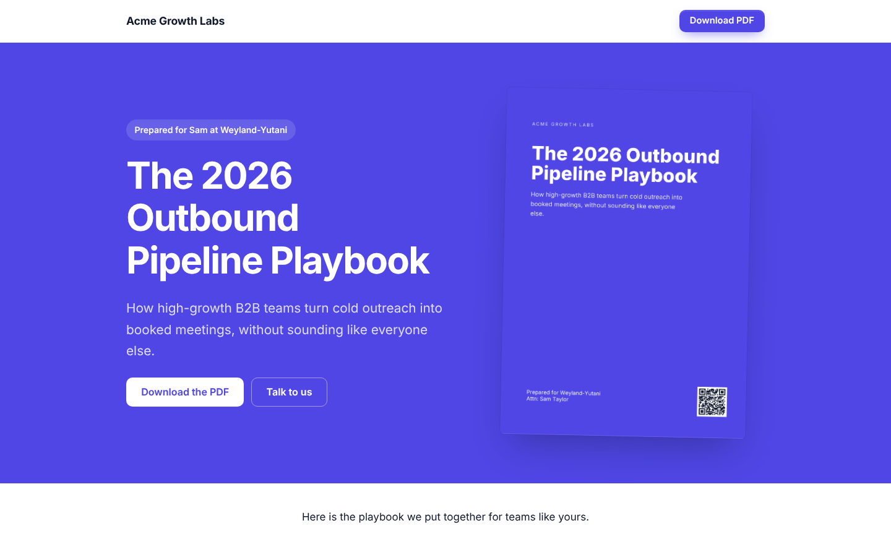
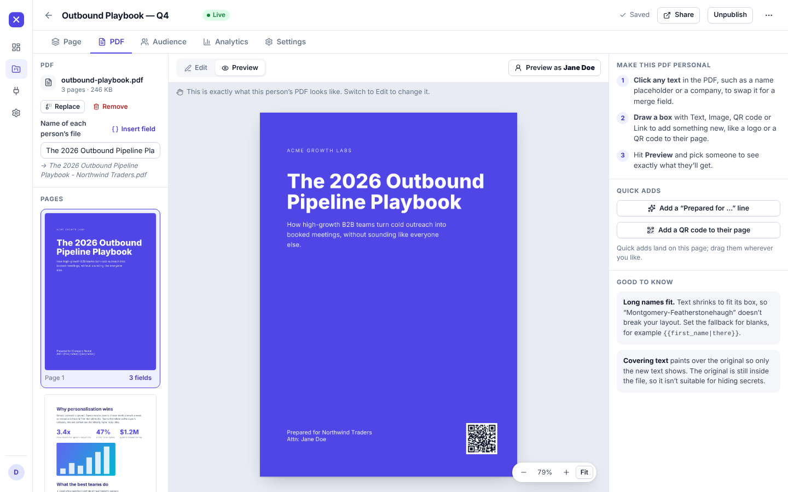
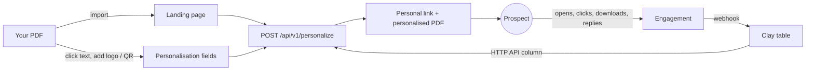
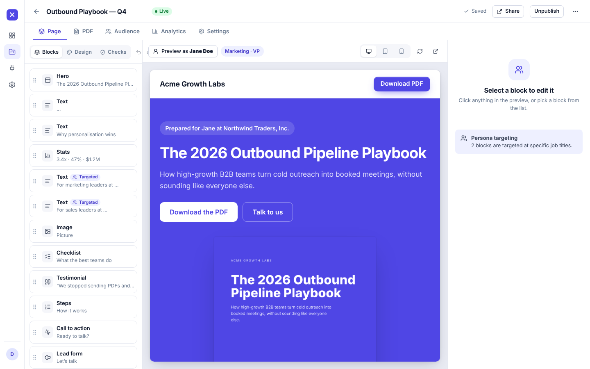
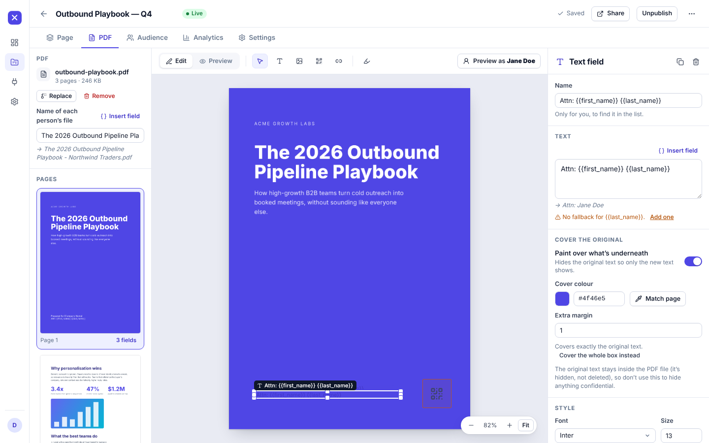
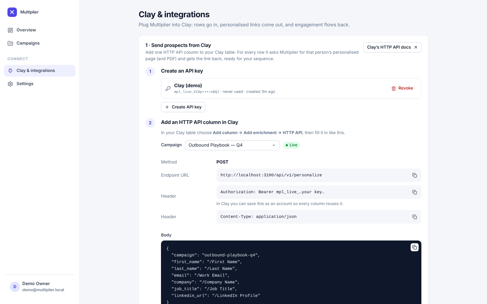
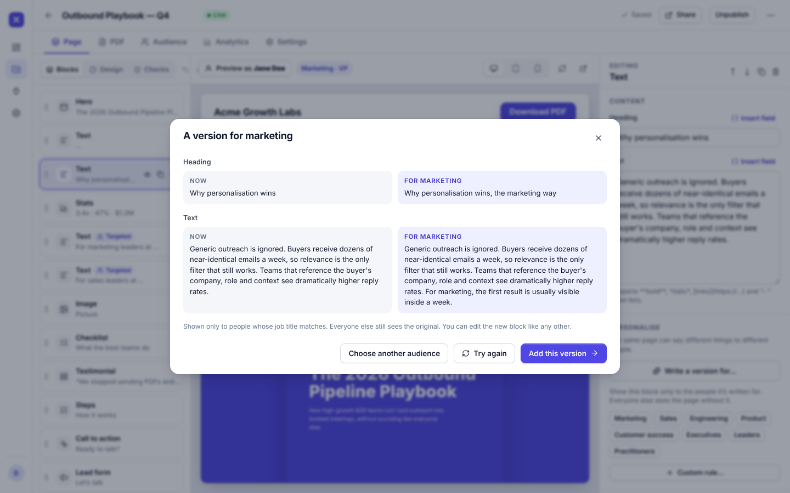
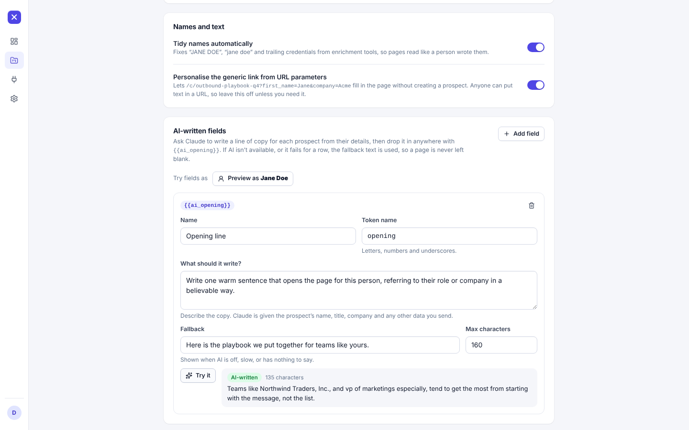

# Multiplier

**Turn one PDF into a personalised landing page and a personalised PDF for every prospect.** Plugs into [Clay](https://www.clay.com).

Give it the case study, one-pager or playbook you already send. Multiplier builds a landing page from it, and lets you mark the words, logos and QR codes in the PDF that should change per person. Then Clay (or a CSV) feeds it prospects, and every row gets a private link and PDF with their name, company, logo and the right message for their job title, plus tracking so you know who actually read it.

It's an Unbounce-style page builder where the starting point is a PDF and the data is your prospect list.

<p align="center">
  
  
</p>



## What you get

| | |
|---|---|
| **PDF → landing page** | Upload a PDF; headings, lists, stats, quotes, images, steps and a call to action are detected and laid out as an editable page in your brand colour. Scanned PDFs get a sensible fallback. |
| **Edit PDFs in place, per prospect** | In the PDF studio, click any text to swap it for a merge field (`Prepared for {{company}}`), or draw text, logo, QR code and link boxes. Each prospect gets their own copy; long names shrink to fit, the original text is covered, and you can preview as any person. |
| **Merge fields that don't break** | `{{first_name\|there}}` fallbacks, filters (`upper`, `title`, `possessive`…), derived fields (seniority, department and a clean company name from the job title and company), tidy-up of ALL-CAPS names. |
| **Persona targeting** | Show a block only to marketers, executives or any rule you write, based on job title or any field Clay sends. |
| **Built for Clay** | One HTTP API column returns each row's link (idempotent, with warnings for anything missing). Engagement flows back into a Clay table, Slack, or your own endpoint. |
| **Tracking that ignores robots** | Opens, reading time, clicks, PDF downloads and form replies, with link scanners and previews filtered out so open rates aren't fantasy. |
| **Optional AI** | A personal opening line per prospect, a rewrite of any block for a given audience, and light polish when you import a PDF. Off unless you add an Anthropic key, and always falls back to your own text. |

<p align="center">
  
  
</p>

## Quick start

You need **Node 22.13 or newer**.

```bash
git clone <this repo> && cd multiplier-
npm install
cp .env.example .env        # optional for local use
npm run seed                # optional: a demo workspace with 28 prospects and activity
npm run dev                 # API on :3000, dashboard on http://localhost:5173
```

Open <http://localhost:5173>. On a fresh database you'll be asked to create your account; after `npm run seed` sign in with `demo@multiplier.local` / `multiplier-demo`.

Then: **New campaign → drop a PDF → publish.** The Integrations screen walks through connecting Clay.

### Production build

```bash
npm run build
npm start                   # serves the dashboard, API and personalised pages on $PORT (default 3000)
```

### Docker

```bash
cp .env.example .env        # set APP_URL (and PUBLIC_URL), ADMIN_EMAIL / ADMIN_PASSWORD
docker compose up -d        # http://localhost:3000, data in the `multiplier-data` volume
```

For HTTPS on your own domain, set `APP_HOST`, `ACME_EMAIL` and `TRUST_PROXY=true` in `.env`, point DNS at the server and run:

```bash
docker compose --profile proxy up -d
```

The bundled Caddy gets certificates automatically for the dashboard host and for each link domain you add under **Settings → Your own domains** (it asks the app first, so it only ever issues certificates for domains you've added). Seed demo data inside the container with `docker compose run --rm app node --disable-warning=ExperimentalWarning dist/seed.js`.

## Using it with Clay

1. **Create an API key** (Integrations → Create API key). It is shown once.
2. In your Clay table, **add an HTTP API column**: `POST https://<your-app>/api/v1/personalize`, header `Authorization: Bearer mpl_live_…`, and a JSON body that maps your columns:

   ```json
   {
     "campaign": "outbound-playbook-q4",
     "first_name": "/First Name",
     "last_name": "/Last Name",
     "email": "/Work Email",
     "company": "/Company Name",
     "job_title": "/Job Title",
     "linkedin_url": "/LinkedIn Profile"
   }
   ```

   (Type `/` inside the quotes and pick the Clay column.) Return `url` (and `pdf_url`, `cover_url` if you want them) as columns.
3. **Use the link** in your email or LinkedIn step. Re-running a row returns the same link, so nothing is duplicated.
4. **Send engagement back** (optional): add a webhook destination (Clay table, Slack or your own endpoint) and every open, click, download and reply becomes a row you can act on.

Anything extra you send (`industry`, `pain_point`, a news item…) becomes a merge field `{{industry}}`. Full walkthrough, error handling and rate limits: **[docs/clay.md](docs/clay.md)**.

<p align="center"></p>

## Concepts

### Merge fields

```text
{{first_name}}                 the value, or nothing if unknown
{{first_name|there}}           fallback when empty        → "Hi there,"
{{company|upper}}              filter                     → "NORTHWIND TRADERS"
{{company|title|"your team"}}  filters and fallbacks chain left to right
```

Filters: `upper`, `lower`, `title`, `capitalize`, `trim`, `first_word`, `last_word`, `initials`, `possessive`, `truncate:N`, `domain`. Keys are forgiving: `{{ Company Name }}` is `{{company_name}}`.

Fields available everywhere: `first_name`, `last_name`, `full_name`, `email`, `job_title`, `company`, `company_short` (legal suffixes removed), `domain`, `website`, `logo_url`, `linkedin_url`, `page_url`, `pdf_url`, `today`, and the derived **segment** fields `seniority` (`owner`, `c_level`, `vp`, `head`, `director`, `manager`, `senior`, `individual`, `junior`), `seniority_group` (`executive`, `leader`, `practitioner`) and `department` (`sales`, `marketing`, `product`, `engineering`, `design`, `data`, `operations`, `finance`, `hr`, `it`, `customer_success`, `legal`, `executive`, `other`) with `seniority_label` and `department_label` for display. Any other field Clay sends is available under its own name.

Prospect data is never interpreted as markup: values are escaped when they are placed on a page, and the page's own formatting (`**bold**`, links) is processed before data is merged in.

### Persona targeting

Any block can carry a rule such as `department is marketing` or `seniority_group is executive` (`is`, `is not`, `contains`, `starts with`, `is one of`, `matches pattern`, `is known`… combined with *all* / *any*). The builder shows which blocks are targeted and previews the page as any person. With AI on, **Write a version for…** drafts the marketing, sales or executive version of a block and sets the targeting for you.

### The PDF studio

- **Click text** in the PDF to replace it with a merge field. Multiplier remembers where the original sat, covers it with the sampled background colour and writes the new text in a matching font and size, shrinking long names to fit.
- **Draw boxes** to add text, a picture (use `{{logo_url}}` for each company's logo), a QR code to the prospect's page, or a clickable link.
- **Preview as** any sample person, a real prospect, or nobody (to see the fallbacks).
- Each prospect's PDF is generated once and cached; edit a field or their data and it is rebuilt.

> Covering original text paints over it, it doesn't delete it: the text is still inside the PDF file. Don't use the studio to hide anything confidential.

### Tracking

Public pages set no cookies. Each visit sends an anonymous per-visit ID; IP addresses are stored only as a salted daily hash, and the browser's user-agent string is kept (truncated) to tell people from robots. A **view** needs a real browser running the page's script, and known link scanners, security gateways, previews and headless browsers are ignored. A prospect is *Not opened → Opened → Engaged* (clicked, downloaded, or read for a while) *→ Converted* (submitted the form or booked a meeting). The score on each prospect rewards deliberate actions over repeat opens.

### Optional AI

Set `ANTHROPIC_API_KEY` and three things appear: **AI fields** (a short personal line per prospect, used as `{{ai_opening}}`), **Write a version for…** on text blocks, and a polish step on PDF import that never overrides copy that already reads well. Per-prospect copy uses `AI_MODEL_FAST` (default `claude-haiku-5-5`); page work uses `AI_MODEL_SMART` (default `claude-opus-5-5`). Failures, timeouts and refusals fall back to your fallback text and show up as `warnings` in the API response. For AI fields, a prospect's name, company, job title and custom fields are sent to Anthropic; email addresses and LinkedIn URLs never are. Try the screens without a key using `npm run dev:fake-ai`.

<p align="center">
  
  
</p>

## API

Machine API for Clay and anything else that can send JSON. Authenticate with `Authorization: Bearer mpl_live_…` (keys can be limited to one campaign).

| Endpoint | |
|---|---|
| `POST /api/v1/personalize` | Create or update one prospect and get their links. Idempotent: matched by `external_id`, email or LinkedIn URL. |
| `POST /api/v1/personalize/batch` | Up to 500 rows per call; each row succeeds or fails on its own. |
| `GET /api/v1/prospects?email=` / `?external_id=` / `?stage=` | Look prospects up, e.g. "has she opened it?" |
| `GET /api/v1/prospects/:id` | One prospect with engagement. |
| `GET /api/v1/ping`, `GET /api/v1/campaigns` | Test the key; list campaigns it can use. |

```bash
curl -X POST https://app.example.com/api/v1/personalize \
  -H "Authorization: Bearer mpl_live_…" -H "Content-Type: application/json" \
  -d '{"campaign":"outbound-playbook-q4","first_name":"Jane","company":"Northwind Traders","job_title":"VP of Marketing"}'
```

```json
{
  "ok": true, "status": "created", "id": "prs_…",
  "url": "https://go.example.com/p/k3x9Qm2aWd",
  "pdf_url": "https://go.example.com/p/k3x9Qm2aWd.pdf",
  "cover_url": "https://go.example.com/p/k3x9Qm2aWd/cover.png",
  "headline": "The 2026 Outbound Pipeline Playbook",
  "seniority": "vp", "department": "marketing",
  "warnings": []
}
```

Errors are `{ "error": { "code", "message" } }`: `401` bad key, `403` key limited to another campaign, `404` unknown campaign, `422` a field the campaign requires is missing (no link is issued), `429` slow down (`Retry-After` is set). Keys are rate limited to 600 requests a minute.

**Webhooks** (Integrations → Add destination) fire on `prospect.created`, `page.first_viewed`, `page.viewed`, `link.clicked`, `pdf.downloaded`, `form.submitted` and `meeting.booked`. Clay and Slack get flat, ready-to-use payloads; custom endpoints get a JSON envelope signed with `x-multiplier-signature: sha256=HMAC(secret, "{timestamp}.{body}")`. Deliveries are queued and retried with backoff for several hours. Payload examples: [docs/clay.md](docs/clay.md#sending-engagement-back-to-clay).

## Configuration

All configuration is environment variables (a `.env` file in the working directory is read for local runs; the real environment always wins). Everything has a sensible default.

| Variable | Default | |
|---|---|---|
| `PORT`, `HOST` | `3000`, `0.0.0.0` | Where to listen. |
| `DATA_DIR` | `./.data` | SQLite database, uploaded PDFs and generated files. **Back this up.** |
| `APP_URL` | `http://localhost:$PORT` | Dashboard and API origin (cookies, webhooks). |
| `PUBLIC_URL` | `APP_URL` | Origin of the links you send. Use a dedicated domain (`https://go.yourbrand.com`) to protect your main domain's reputation. |
| `APP_SECRET` | generated into `DATA_DIR/secret.key` | Signs sessions and encrypts stored secrets (min. 16 characters). |
| `TRUST_PROXY` | `false` | Set `true` (or the number of proxies) behind Caddy, nginx or a load balancer. |
| `COOKIE_SECURE` | on when `APP_URL` is https | |
| `ADMIN_EMAIL`, `ADMIN_PASSWORD` | – | Create the owner on first boot (handy for containers). |
| `MAX_UPLOAD_MB` | `25` | Largest PDF. |
| `ANTHROPIC_API_KEY` | – | Turns AI on. |
| `AI_MODEL_SMART`, `AI_MODEL_FAST`, `AI_TIMEOUT_MS` | `claude-opus-5-5`, `claude-haiku-5-5`, `20000` | See [Optional AI](#optional-ai). |
| `ALLOW_PRIVATE_FETCH` | `false` | Let outbound requests (webhooks, logo images) reach private addresses. For local development only. |
| `LOG_LEVEL` | `info` | `debug`, `info`, `warn`, `error`. |

## Security

Built for the fact that prospect data is untrusted and the links go to strangers.

- **No injection through data.** Values are HTML-escaped at render time; custom HTML blocks are sanitised after merge; every public page gets a per-response CSP nonce and `frame-ancestors 'none'`; links are limited to safe schemes.
- **Private, unguessable links** (`/p/<10 random chars>`), `noindex`, no cookies; unknown tokens are rate limited.
- **Dashboard** uses scrypt password hashes, hashed server-side sessions in an `HttpOnly` `SameSite` cookie, same-origin checks on writes and login throttling. The dashboard and API answer only on the app host; custom domains serve personalised pages and nothing else.
- **API keys** are stored hashed and can be revoked or limited to one campaign. Webhook secrets and auth headers are encrypted at rest.
- **Outbound requests** (webhooks, logo images) refuse private and link-local addresses, revalidate after redirects and have size and time limits.
- **Uploads** are checked by content, size-limited and processed in bounded, time-boxed jobs; uploaded images are re-encoded (stripping metadata). CSV exports neutralise formula injection.
- **AI** receives only what's listed under [Optional AI](#optional-ai), and its output is treated as untrusted text.

See [SECURITY.md](SECURITY.md) for the details and how to report a problem. Multiplier doesn't send email: you stay responsible for lawful outreach (consent, opt-out, data-protection rules) wherever your prospects are.

## Development

```bash
npm run dev            # API (watch) + dashboard (Vite, proxied)
npm test               # 260+ unit and integration tests
npm run typecheck
npm run build          # dashboard + server bundle in dist/
npm run smoke -- http://localhost:3000   # end-to-end check of a running server (needs a fresh instance)
npm run seed           # demo workspace
npm run dev:fake-ai    # server with a scripted stand-in for Claude, to try the AI screens offline
node scripts/screenshots.mjs http://localhost:3100 docs/screenshots   # regenerate screenshots
```

Stack: Node 22 + TypeScript, [Hono](https://hono.dev), built-in `node:sqlite` (WAL), zod, pdf.js + `@napi-rs/canvas` (reading and rasterising), pdf-lib (editing), React + Vite + TanStack Query for the dashboard, and server-rendered HTML for the public pages. There's no Tailwind and no CSS framework: the design system is a few hundred lines of plain CSS. Architecture notes and the reasoning behind the PDF pipeline are in **[docs/architecture.md](docs/architecture.md)**.

CI (`.github/workflows/ci.yml`) runs typecheck and tests, builds the production bundle and runs the smoke test against it with production dependencies only, and builds the Docker image.

## Known limits

- One workspace per install: there's a single owner account today, with no team invites yet.
- The PDF studio edits text, images, QR codes and links. It doesn't reflow whole pages. Rotated pages aren't edited (you get a warning), and *replacement* text is drawn in Latin, Latin-Extended, Cyrillic, Greek and Vietnamese: other scripts (CJK, Arabic, Hebrew, Thai…) come out as “?” and the preview lists the characters it couldn't draw.
- PDFs that are scans (no text layer) get a starter page with placeholder copy for you to edit, and can still carry QR codes, logos and links.
- Multiplier generates links and tracks engagement; it doesn't send emails. Pair it with whatever sequencer you already use in Clay.
- SQLite via `node:sqlite` is still flagged experimental by Node. It's stable in practice (and tested here), but pin your Node version in production.
