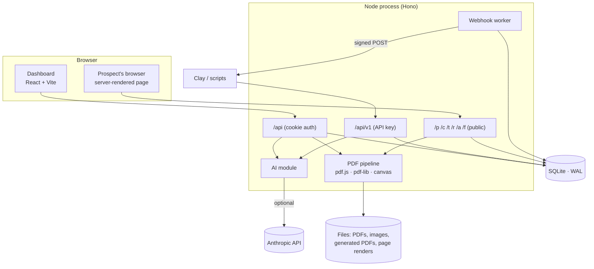

# Architecture

A single Node process serves everything: the dashboard (a Vite-built React app), the dashboard API, the machine API for Clay, and the personalised pages and PDFs that prospects open. State is one SQLite file plus a folder of files, both under `DATA_DIR`.



## Layout

```
src/
  shared/            Pure TypeScript used by the server AND the dashboard, so they can't drift
    schema.ts          the single zod contract: blocks, theme, PDF fields, settings, campaigns
    template.ts        {{merge}} engine: tokens, fallbacks, filters
    derive.ts          seniority / department / clean company & names from raw data
    conditions.ts      persona rules (evaluate, describe, invert)
    lint.ts            "checks" shown in the builder (missing fallbacks, unknown fields…)
    color.ts           colour maths: tints, contrast, "readable on", hue shifts
    presets.ts         the seven one-click styles, each a function of the brand colour
    templates.ts       the six starter pages offered by "new campaign"
    blocks.ts, fields.ts, personas.ts, block-text.ts
  server/
    app.ts, http.ts    wiring, middleware, CSRF, rate limiting, host guard
    routes/            auth, campaigns, documents (PDF studio), prospects, analytics, settings, ai, v1, public
    services/          campaigns, prospects, events, analytics, webhooks, importer, documents, ai, brands, …
    render/            server-side page rendering: blocks, CSS, fonts, rich text, icons, embeds, CSP
    pdf/               extract (pdf.js), raster, import (PDF → page), apply (edit PDFs), fonts, fields
    auth/              users (scrypt), sessions, API keys
    lib/               crypto, safe-fetch (SSRF guard), storage, rate limiter, logging
    db/                node:sqlite wrapper and migrations
web/src/             Dashboard: pages, builder, PDF studio, charts, UI kit (plain CSS, no framework)
scripts/             seed, smoke test, screenshots, fake-AI dev server, try-design (the designer against the real API, with its cost)
tests/               unit + integration (the app is exercised in-process through `app.request`)
```

## Three surfaces, three trust levels

| Surface | Auth | Who calls it | Notes |
|---|---|---|---|
| Public: `/p/<token>`, `/c/<slug>`, `/t`, `/tc`, `/r`, `/a`, `/f` | none (an unguessable token is the credential) | Prospects, link scanners, bots | Served on the links host and any custom domain. Tiny body limits, per-token rate limits, strict CSP, `noindex`. |
| Dashboard API: `/api/*` | HttpOnly session cookie, same-origin checks on writes | The dashboard | Answers on the **app host only**. |
| Machine API: `/api/v1/*` | `Authorization: Bearer mpl_live_…` | Clay, scripts | 600 requests/min per key; optionally limited to one campaign. |

A host guard enforces the split: on any host other than `APP_URL`'s, only the public path prefixes answer (plus the proxy's certificate check, to internal callers only). Page content can therefore never reach the dashboard's cookies, even on a customer's own domain.

## Data model

SQLite (WAL, foreign keys on). Writers are synchronous and tiny, so there's one writer and no lock juggling.

| Table | Holds |
|---|---|
| `users`, `sessions` | Owner account (scrypt hash); sessions stored as hashes |
| `api_keys` | SHA-256 of each key, prefix and last four for display, optional campaign limit |
| `settings` | Workspace settings as JSON (name, domains, sender, tracking scripts) |
| `assets` | Uploaded PDFs and images: kind, size, SHA-256, storage key, metadata (page sizes, detected tokens) |
| `campaigns` | `page` (blocks + theme + SEO), `document` (the PDF's personalisation fields), `settings`, `source` (import report), `version` for optimistic concurrency |
| `prospects` | Identity columns (email, names, company, title, LinkedIn), `data` (custom fields), `ai` (generated copy), unguessable `token`, engagement counters and score |
| `events` | `hit`, `view`, `engaged`, `click`, `download`, `submit`, `booked` with props, bot flag, salted-hash IP |
| `submissions` | Form answers |
| `webhooks`, `webhook_deliveries` | Destinations (secrets encrypted) and the delivery outbox |

Pages and PDF fields live as validated JSON inside the campaign row. The schema is one zod contract (`src/shared/schema.ts`) shared by the API and the dashboard: every list and string is bounded, and anything interpolated into CSS is checked against a strict pattern.

## Rendering a personalised page

1. The token resolves to a prospect and campaign (unknown tokens get a plain "not available" page and are rate limited).
2. A context is built: stored fields, then derived fields (seniority, department, short company name, tidy names), AI copy, links.
3. Each block's targeting rule is evaluated; blocks that don't match are never rendered.
4. Text is processed in a fixed order that makes injection structurally impossible: the author's own formatting (`**bold**`, links) is parsed **first**, and only then are merge values substituted into the already-parsed text and HTML-escaped. Data can never become markup. URLs are built with merge values percent-encoded and checked against a scheme allow-list. Custom HTML blocks are merged then sanitised.
5. The page ships with a per-response CSP nonce, a tiny tracking script, and fonts served from the same origin.

### How a page is styled

A page's `theme` (brand colour, neutrals, typefaces, corners, card style, spacing, gradient) becomes a short block of CSS variables (`render/css.ts`), and one fixed stylesheet reads them. Nothing in the theme is free text: colours are 6-digit hex and everything else is an enum, so no theme value can break out of a CSS declaration. A few derived values keep pages legible whatever the author picks: button text switches between white and near-black by contrast (`inkFor`), the brand colour used for links and small labels is nudged lighter or darker only as far as it must be to read on the page (`readableOn`), and cards, borders and shadows adapt when the page background is dark.

Typefaces (Inter, Manrope, Fraunces, Space Grotesk, plus system stacks) are self-hosted from the `@fontsource-variable` packages and served from `/f/<family>/files/<file>` with a one-year immutable cache, so a prospect's browser never contacts a third-party font service. A page only includes the `@font-face` rules, and the preload, for the fonts its theme uses. The file route accepts only the exact `<family>-<subset>-wght-normal.woff2` names of the packages we ship.

A *style preset* (`shared/presets.ts`) is a function from the brand colour to the rest of the theme, so applying one keeps your brand colour and any accent and re-derives the tints and dark shades to suit it. The PDF importer picks one for you: a document set mostly in a serif face becomes *Editorial*, a dark document becomes *Midnight*, anything else *Clean*.

The dashboard's live preview posts the *unsaved draft* to `/api/campaigns/:id/preview`, which renders it with the same code and returns a short-lived URL that is loaded in a double-buffered iframe (so edits swap in without flicker). Clicking a block in the preview selects it in the editor.

## The PDF pipeline

PDFs come from the internet, so every operation is concurrency-limited (2 at a time), time-boxed and page-capped (100 pages).

**Reading** (`pdf/extract.ts`, `pdf/raster.ts`): pdf.js yields text runs with their font, size and position in PDF points (top-left origin). Pages are rasterised with `@napi-rs/canvas`; background and text colours are sampled from the render, which is how replacement text can match what it replaces.

**PDF → landing page** (`pdf/import.ts`): geometric line clustering restores reading order (positioned text isn't stored in reading order). Text set in aligned columns is found first (`gatherTables`: three or more rows whose cells line up, rejecting columns of running text, rows of big figures and numbered lists) and becomes a `table` block. Columns are found from gaps that no line of body text crosses (any number of them, so a row of three cards reads card by card), a heading below every column starts a new band, and a sentence that runs over a page or column break stays one paragraph. Numbers drawn in a circle beside their text are joined back onto it (`joinBadges`), raised footnote marks are dropped, and letter-spaced headings are repaired. Headers, footers, page furniture and contents pages are dropped; the cover is detected; then headings, bullet and numbered lists, stat rows (big number + caption, or one big figure on its own), pull quotes with attributions (a name and role under the quote, even far below on a slide), steps (with a description under each title), fact boxes (bold label over a value), a slide that is one big sentence (a `callout`), three or more short title-and-sentence sections side by side (a `features` block) and a call to action are recognised. The brand colour is picked from the most saturated, most common pixels of the first pages. Text in your PDF that already looks like `{{first_name}}` becomes a ready-made field. This is the path used when AI is off or the designer below fails; with AI on, it is followed by a conservative polish pass.

**Designing the page with Claude** (`services/designer.ts`, `pdf/design-plan.ts`, `pdf/design-input.ts`): the model is shown each page as a JPEG (up to 14: the first 11 and last 3 of a longer document) with the extracted text of every page, numbered and with sizes, an inventory of the images embedded in the PDF, the palette, and the merge tokens found. It answers, through structured output, with a *plan*: a style, the hero, and an ordered list of blocks drawn from a fixed vocabulary, each naming its words and, for a picture, either an embedded image or a region of a page (0 to 1000 grid, cut out by `cropRaster`). The schema has no nullable fields, because structured outputs allow only 16 union-typed properties in a whole schema and a block has more fields than that which most block types don't use: every field is required, one a block doesn't use is left empty, and `readPlan` reads empty as unset (a test keeps the union count at zero). The request is made once, with no retry, so a slow answer costs the timeout once rather than twice. `assemblePage` then does the checking and the building: every number with two digits or a unit in a block must occur in the PDF's text, the words of each block must be mostly found in the PDF (grounding), a block that fails is dropped rather than repaired, the page is capped at twelve content blocks and four pictures, and each surviving block is rebuilt from `newBlock` defaults with cleaned strings (markup, control characters and unknown merge tokens removed), so no field the model invents reaches the page. The plan is rejected as a whole if it has no headline, too little of it survives, more than 35% of it was dropped, or its wording strays from the document. A rejection, an API failure, a timeout or an unusable reply falls back to the rule-based import and says why in the import report. A designed page is not polished again.

**Editing a PDF per prospect** (`pdf/apply.ts`): fields are resolved against a prospect's context into plain *instructions* (the cache key: same instructions, same output), then drawn onto the original with pdf-lib:

- A text field has a *layout box* (where new text goes) and a separate *mask* (what to paint over). That is why replacing `[Company]` with `Globex International` works even though the new text is longer.
- Text is fitted by shrinking, wrapping or ellipsis; fonts are Inter (WOFF1 subsets covering Latin, Latin-Extended, Cyrillic, Greek and Vietnamese, embedded through fontkit), Helvetica, serif and mono. Characters that can't be drawn are reported in the preview rather than silently dropped.
- Images are fitted by `contain` or `cover`; QR codes are drawn as vectors; link fields become real PDF link annotations.
- Output is **content-addressed** (`SHA-256(source PDF) + resolved instructions`), stored per prospect, and rebuilt only when something that affects it changes. Concurrent requests for the same output share one render.

The studio (`web/src/pages/pdf/`) is a canvas over the page image: detected text runs are clickable, fields are boxes you drag and resize, preview renders the real output server-side.

## Tracking

The page's script posts anonymous beacons (`view`, `engaged` with seconds and scroll depth, `booked`) with a per-visit random ID: no cookies, no storage. The server ignores anything whose user-agent is a known scanner, preview bot or security gateway, or that reports `navigator.webdriver`. `view` is deduplicated per session; `engaged` is a running total per session. Counters and a bounded score (opens, clicks, downloads, replies, reading time) are kept on the prospect row; analytics count human activity only.

## Webhooks

Events are written to an outbox table at the moment they happen, then delivered by a background worker that claims rows before sending: 10-second timeout, SSRF-safe fetch (private and link-local addresses refused, redirects revalidated, response size capped), retries after 1m, 5m, 30m, 2h and 6h. Secrets and auth header values are encrypted with a key derived from `APP_SECRET`. Custom endpoints get an HMAC-signed envelope; Clay and Slack get flat payloads.

## AI

`services/ai.ts` is the only place that talks to Claude, behind a one-method backend interface (so tests and the offline demo script substitute a fake). Every entry point degrades to fallback text and reports `warnings`. Concurrency is capped, calls are time-boxed, and a circuit breaker stops asking a failing service (longer for a rejected key). Prospect data enters prompts as escaped JSON in one delimited block with contact details removed; replies are treated as untrusted text (markup, links and merge tokens stripped, length-capped). Structured outputs (`output_config.format`) guarantee the reply shape. Per-prospect copy is cached against a hash of its inputs, so re-running a row costs nothing. Length is handled in three steps, because measured against the live API the writer overshoots a stated character limit by 20 to 50%: it is asked for a lower target (`softLimit`, 80% of the cap) and a number of words (`wordBudget`), a reply still over the cap is sent back once to a second call that only shortens it, and the last resort (`fitTo`) cuts at a whole sentence, then a clause, then a word. The page's language is stated in the prompt so a German job title doesn't produce German copy on an English page. A block made only of merge fields is refused before any call is made.

## Brand kits

A brand kit (`BrandKitSchema` in `shared/schema.ts`, one row in the `brands` table with the kit as JSON, one marked default) holds colours, the typefaces we can serve that come closest to the brand's own, a logo, a preferred style, and the brand's voice, words to use and avoid, and rules. Nothing is bound live: `applyBrand` (`shared/brand.ts`, pure, used by the server and the Design panel) copies a kit onto a page's theme once, and a campaign records which kit it follows in `settings.brand_id` (empty means the default brand, `none` means no brand). It keeps the page's own look, or the one the kit names, re-deriving the tints from the new brand colour, and replaces a text colour that wouldn't read on the background. Whether a page is light or dark is part of its design, so a brand never flips it: a white website's background and dark text leave a dark invitation dark (a dark page may take the kit's dark colour as its background instead), and the bands between sections stay neutral rather than taking on the brand's hue. The kit's dark-section colour is only used when it is dark enough for the light text laid on it. A kit that wants the other mood names a style.

The voice is used live. `brandVoiceFor` (`services/brands.ts`) puts a kit's notes in a `<brand_voice>` block in the prompts for per-prospect copy and persona variants, and `buildDesignPrompt` adds a `<brand>` block for the designer. Brand text is stripped of angle brackets, so it can't close the block it sits in, and the block says it never changes the task, the output format or the length limits. `callAi` logs each page-level call with its tokens.

Two readers propose a kit and save nothing (a person reviews, edits and saves it), and each returns notes saying what it found and what it did not:

- **A website** (`services/brand-site.ts`, analysis in `brand/site.ts`): fetched with `safeRequest`, the same SSRF-safe client as webhooks (private addresses refused after DNS resolution and on every redirect, size and time caps, https only unless `ALLOW_PRIVATE_FETCH` is set for development and tests), the home page plus up to four stylesheets. Colours are tallied by where they are used (a CSS variable named primary, button and link selectors, the theme colour weigh most), the brand colour is the most prominent saturated one, the accent the best colour of a clearly different hue, and text, background and dark colours come from the neutrals used for each job. Typefaces are mapped to the nearest of ours by a table. The logo is the first usable image in the header, else the touch icon (SVG and ICO are refused, since SVG can carry script and `storeImage` re-encodes only raster images). With AI on, Claude describes the voice from the page's text, which goes to it as escaped JSON and is described as data.
- **A guidelines PDF** (`services/brand-guidelines.ts`, scan in `brand/guidelines.ts`): hex and RGB codes with the name and role printed beside each, typeface names from a list, the tone-of-voice passage and do and don't lines. With AI on, up to 12 pages go to the larger model as pictures with the text, and the reply (colours, typefaces, voice, words to use and avoid, rules) is checked: a colour must be a hex code, and one that isn't printed in the document is flagged as an estimate. The schema has no unions, as with the designer's.

**Redesign** (`redesignCampaign` in `services/importer.ts`) rebuilds a page from a campaign's own PDF with a chosen brand and with or without Claude, as a copy: the copy gets a clone of the PDF and the same personalisation fields, and the original isn't touched. The importer's page-building step (`buildPage`) is separate from storing the PDF so imports and redesigns share it.

## Dashboard

- **State**: React Query for server data; a `CampaignProvider` holds the *draft* of the page, PDF fields and settings. Edits autosave 1.2 s after the last change with `base_version` for optimistic concurrency (a second tab gets a "changed elsewhere" prompt instead of silently clobbering). Page edits have undo/redo with typing coalesced.
- **Page builder**: block list (drag and drop, keyboard accessible), block editor driven by a per-type form description, design panel, "checks" (lint) and the live preview.
- **Charts** are hand-drawn SVG with one validated colour palette, a table view of each chart, and keyboard-accessible tooltips.
- **Styling**: plain CSS with design tokens; no framework. The public pages use their own minimal CSS emitted per page.

## Decisions worth knowing

- **SQLite, one process.** The workload is read-heavy pages plus small writes; one file is trivial to back up and run. `node:sqlite` is still marked experimental by Node, so pin the Node version. Moving to Postgres would mean replacing `db/` and the SQL in `services/`.
- **Server-rendered public pages.** Fast on any phone, no client bundle, no hydration, and nothing prospect-specific ever sits in a JS payload.
- **Cover-up masks rather than true text removal.** Editing PDF content streams reliably across arbitrary producers isn't feasible; painting a sampled background over the original is. The trade-off (the original text stays in the file) is documented in the studio.
- **No bundled email sender.** Multiplier's job is the link, the page, the PDF and the signal. Sending belongs to the sequencer you already use in Clay.

## Scaling and hardening notes

- PDF work runs in the main process behind a 2-slot gate. Heavy PDF traffic would be better isolated in worker threads or a separate worker process; the gate and timeouts keep a pathological file from starving page views in the meantime.
- Local disk storage sits behind a tiny interface (`lib/storage.ts`); swap it for S3 to run several instances (SQLite would also need to move).
- Back up `DATA_DIR` (use `sqlite3 multiplier.db ".backup 'copy.db'"` or stop the process while copying, since WAL files are involved).
