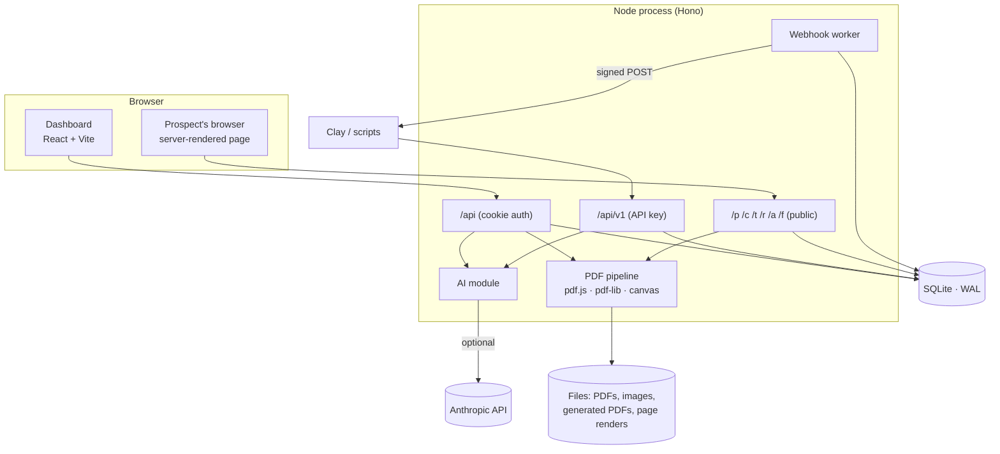

# Architecture

A single Node process serves everything: the dashboard (a Vite-built React app), the dashboard API, the machine API for Clay, and the personalised pages and PDFs that prospects open. State is one SQLite file plus a folder of files, both under `DATA_DIR`.



## Layout

```
src/
  shared/            Pure TypeScript used by the server AND the dashboard, so they can't drift
    schema.ts          the single zod contract: blocks, theme, PDF fields, settings, campaigns
    template.ts        {{merge}} engine: tokens, fallbacks, filters
    derive.ts          seniority / department / clean company & names from raw data
    conditions.ts      persona rules (evaluate, describe, invert)
    lint.ts            "checks" shown in the builder (missing fallbacks, unknown fields…)
    blocks.ts, fields.ts, personas.ts, block-text.ts
  server/
    app.ts, http.ts    wiring, middleware, CSRF, rate limiting, host guard
    routes/            auth, campaigns, documents (PDF studio), prospects, analytics, settings, ai, v1, public
    services/          campaigns, prospects, events, analytics, webhooks, importer, documents, ai, …
    render/            server-side page rendering: blocks, CSS, rich text, icons, embeds, CSP
    pdf/               extract (pdf.js), raster, import (PDF → page), apply (edit PDFs), fonts, fields
    auth/              users (scrypt), sessions, API keys
    lib/               crypto, safe-fetch (SSRF guard), storage, rate limiter, logging
    db/                node:sqlite wrapper and migrations
web/src/             Dashboard: pages, builder, PDF studio, charts, UI kit (plain CSS, no framework)
scripts/             seed, smoke test, screenshots, fake-AI dev server
tests/               unit + integration (the app is exercised in-process through `app.request`)
```

## Three surfaces, three trust levels

| Surface | Auth | Who calls it | Notes |
|---|---|---|---|
| Public: `/p/<token>`, `/c/<slug>`, `/t`, `/tc`, `/r`, `/a`, `/f` | none (an unguessable token is the credential) | Prospects, link scanners, bots | Served on the links host and any custom domain. Tiny body limits, per-token rate limits, strict CSP, `noindex`. |
| Dashboard API: `/api/*` | HttpOnly session cookie, same-origin checks on writes | The dashboard | Answers on the **app host only**. |
| Machine API: `/api/v1/*` | `Authorization: Bearer mpl_live_…` | Clay, scripts | 600 requests/min per key; optionally limited to one campaign. |

A host guard enforces the split: on any host other than `APP_URL`'s, only the public path prefixes answer (plus the proxy's certificate check, to internal callers only). Page content can therefore never reach the dashboard's cookies, even on a customer's own domain.

## Data model

SQLite (WAL, foreign keys on). Writers are synchronous and tiny, so there's one writer and no lock juggling.

| Table | Holds |
|---|---|
| `users`, `sessions` | Owner account (scrypt hash); sessions stored as hashes |
| `api_keys` | SHA-256 of each key, prefix and last four for display, optional campaign limit |
| `settings` | Workspace settings as JSON (name, domains, sender, tracking scripts) |
| `assets` | Uploaded PDFs and images: kind, size, SHA-256, storage key, metadata (page sizes, detected tokens) |
| `campaigns` | `page` (blocks + theme + SEO), `document` (the PDF's personalisation fields), `settings`, `source` (import report), `version` for optimistic concurrency |
| `prospects` | Identity columns (email, names, company, title, LinkedIn), `data` (custom fields), `ai` (generated copy), unguessable `token`, engagement counters and score |
| `events` | `hit`, `view`, `engaged`, `click`, `download`, `submit`, `booked` with props, bot flag, salted-hash IP |
| `submissions` | Form answers |
| `webhooks`, `webhook_deliveries` | Destinations (secrets encrypted) and the delivery outbox |

Pages and PDF fields live as validated JSON inside the campaign row. The schema is one zod contract (`src/shared/schema.ts`) shared by the API and the dashboard: every list and string is bounded, and anything interpolated into CSS is checked against a strict pattern.

## Rendering a personalised page

1. The token resolves to a prospect and campaign (unknown tokens get a plain "not available" page and are rate limited).
2. A context is built: stored fields, then derived fields (seniority, department, short company name, tidy names), AI copy, links.
3. Each block's targeting rule is evaluated; blocks that don't match are never rendered.
4. Text is processed in a fixed order that makes injection structurally impossible: the author's own formatting (`**bold**`, links) is parsed **first**, and only then are merge values substituted into the already-parsed text and HTML-escaped. Data can never become markup. URLs are built with merge values percent-encoded and checked against a scheme allow-list. Custom HTML blocks are merged then sanitised.
5. The page ships with a per-response CSP nonce, a tiny tracking script, and fonts served from the same origin.

The dashboard's live preview posts the *unsaved draft* to `/api/campaigns/:id/preview`, which renders it with the same code and returns a short-lived URL that is loaded in a double-buffered iframe (so edits swap in without flicker). Clicking a block in the preview selects it in the editor.

## The PDF pipeline

PDFs come from the internet, so every operation is concurrency-limited (2 at a time), time-boxed and page-capped (100 pages).

**Reading** (`pdf/extract.ts`, `pdf/raster.ts`): pdf.js yields text runs with their font, size and position in PDF points (top-left origin). Pages are rasterised with `@napi-rs/canvas`; background and text colours are sampled from the render, which is how replacement text can match what it replaces.

**PDF → landing page** (`pdf/import.ts`): geometric line clustering and column detection restore reading order (positioned text isn't stored in reading order). Headers, footers and page furniture are dropped; the cover is detected; then headings, bullet and numbered lists, stat rows (big number + caption), pull quotes with attributions, steps and a call to action are recognised. The brand colour is picked from the most saturated, most common pixels of the first pages. Text in your PDF that already looks like `{{first_name}}` becomes a ready-made field. With AI on, a conservative polish pass can fill gaps (see below).

**Editing a PDF per prospect** (`pdf/apply.ts`): fields are resolved against a prospect's context into plain *instructions* (the cache key: same instructions, same output), then drawn onto the original with pdf-lib:

- A text field has a *layout box* (where new text goes) and a separate *mask* (what to paint over). That is why replacing `[Company]` with `Globex International` works even though the new text is longer.
- Text is fitted by shrinking, wrapping or ellipsis; fonts are Inter (WOFF1 subsets covering Latin, Latin-Extended, Cyrillic, Greek and Vietnamese, embedded through fontkit), Helvetica, serif and mono. Characters that can't be drawn are reported in the preview rather than silently dropped.
- Images are fitted by `contain` or `cover`; QR codes are drawn as vectors; link fields become real PDF link annotations.
- Output is **content-addressed** (`SHA-256(source PDF) + resolved instructions`), stored per prospect, and rebuilt only when something that affects it changes. Concurrent requests for the same output share one render.

The studio (`web/src/pages/pdf/`) is a canvas over the page image: detected text runs are clickable, fields are boxes you drag and resize, preview renders the real output server-side.

## Tracking

The page's script posts anonymous beacons (`view`, `engaged` with seconds and scroll depth, `booked`) with a per-visit random ID: no cookies, no storage. The server ignores anything whose user-agent is a known scanner, preview bot or security gateway, or that reports `navigator.webdriver`. `view` is deduplicated per session; `engaged` is a running total per session. Counters and a bounded score (opens, clicks, downloads, replies, reading time) are kept on the prospect row; analytics count human activity only.

## Webhooks

Events are written to an outbox table at the moment they happen, then delivered by a background worker that claims rows before sending: 10-second timeout, SSRF-safe fetch (private and link-local addresses refused, redirects revalidated, response size capped), retries after 1m, 5m, 30m, 2h and 6h. Secrets and auth header values are encrypted with a key derived from `APP_SECRET`. Custom endpoints get an HMAC-signed envelope; Clay and Slack get flat payloads.

## AI

`services/ai.ts` is the only place that talks to Claude, behind a one-method backend interface (so tests and the offline demo script substitute a fake). Every entry point degrades to fallback text and reports `warnings`. Concurrency is capped, calls are time-boxed, and a circuit breaker stops asking a failing service (longer for a rejected key). Prospect data enters prompts as escaped JSON in one delimited block with contact details removed; replies are treated as untrusted text (markup, links and merge tokens stripped, length-capped). Structured outputs (`output_config.format`) guarantee the reply shape. Per-prospect copy is cached against a hash of its inputs, so re-running a row costs nothing.

## Dashboard

- **State**: React Query for server data; a `CampaignProvider` holds the *draft* of the page, PDF fields and settings. Edits autosave 1.2 s after the last change with `base_version` for optimistic concurrency (a second tab gets a "changed elsewhere" prompt instead of silently clobbering). Page edits have undo/redo with typing coalesced.
- **Page builder**: block list (drag and drop, keyboard accessible), block editor driven by a per-type form description, design panel, "checks" (lint) and the live preview.
- **Charts** are hand-drawn SVG with one validated colour palette, a table view of each chart, and keyboard-accessible tooltips.
- **Styling**: plain CSS with design tokens; no framework. The public pages use their own minimal CSS emitted per page.

## Decisions worth knowing

- **SQLite, one process.** The workload is read-heavy pages plus small writes; one file is trivial to back up and run. `node:sqlite` is still marked experimental by Node, so pin the Node version. Moving to Postgres would mean replacing `db/` and the SQL in `services/`.
- **Server-rendered public pages.** Fast on any phone, no client bundle, no hydration, and nothing prospect-specific ever sits in a JS payload.
- **Cover-up masks rather than true text removal.** Editing PDF content streams reliably across arbitrary producers isn't feasible; painting a sampled background over the original is. The trade-off (the original text stays in the file) is documented in the studio.
- **No bundled email sender.** Multiplier's job is the link, the page, the PDF and the signal. Sending belongs to the sequencer you already use in Clay.

## Scaling and hardening notes

- PDF work runs in the main process behind a 2-slot gate. Heavy PDF traffic would be better isolated in worker threads or a separate worker process; the gate and timeouts keep a pathological file from starving page views in the meantime.
- Local disk storage sits behind a tiny interface (`lib/storage.ts`); swap it for S3 to run several instances (SQLite would also need to move).
- Back up `DATA_DIR` (use `sqlite3 multiplier.db ".backup 'copy.db'"` or stop the process while copying, since WAL files are involved).
